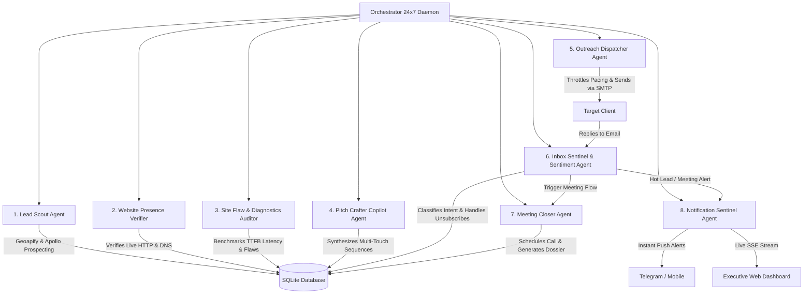

# ⚡ JESORA TECH (jesoratech.com) — 24x7 Autonomous Multi-Agent Client Acquisition System

An enterprise-grade, round-the-clock autonomous multi-agent outreach and client acquisition fleet built specifically for **JESORA TECH** (`jesoratech.com`), Tinkune, Kathmandu, Nepal.

Designed to continuously discover high-fit prospects via Geoapify & Apollo, strictly verify 100% of physical addresses & emails, audit live website presence, run deep technical flaw benchmarks (TTFB latency, mobile layout shift, security headers), synthesize tailored consultative multi-touch sequences, dispatch deliverable cold outreach, monitor inbound replies, classify sentiment with AI, schedule discovery calls, and send real-time push alerts across Telegram and the Executive Web Dashboard.

---

## 🏛 Multi-Agent Fleet Architecture (8 Autonomous Agents)



### The 8 Specialized Agents:

1. **🔍 Lead Scout Agent (`lead_scout`)**
   - Continuously discovers prospects using **Geoapify Places API** and **Apollo.io API**.
   - Enforces **100% data integrity**: strictly validates real registered business name, RFC-compliant email, and verified physical headquarters address (discards any prospect missing verified physical address).
   - Scrapes live `/contact`, `/about`, and footer elements for verified emails.

2. **🌐 Website Presence Verifier Agent (`website_verifier`)**
   - Pings prospect domains with SSL & HTTP status checks.
   - Filters out dead URLs, parked domains, error codes (404/500), and redirects.
   - Guarantees only actively operating businesses proceed into the technical audit.

3. **🔬 Site Flaw & Diagnostics Agent (`site_auditor`)**
   - Benchmarks Time-To-First-Byte (TTFB) latency, payload weights, and Core Web Vitals.
   - Detects missing security headers (`HSTS`, `CSP`, `X-Frame-Options`), viewport issues, and booking friction.
   - Generates a structured JSON Flaw Report with concrete engineering recommendations.

4. **✍️ Pitch Crafter Agent (`pitch_crafter`)**
   - Ingests audited flaw reports and drafts bespoke, consultative outreach emails powered by Gemini Flash.
   - Highlights Jesora Tech's value pillars:
     - **100% Full Source Code Ownership** from Day 1 (zero agency hostage-taking or lock-in).
     - Agile **2-week delivery sprints** with demonstrable live staging previews.
     - **40–60% development cost advantage** with Silicon Valley engineering standards.
   - Dynamically pairs prospects with relevant **Jesora Tech live case studies**:
     - *AI SaaS / Startups* → WriteWell (`writewell.space`)
     - *Service / Automotive / Booking* → MOTOFIX HUB (`motohubfix.vercel.app`)
     - *E-Commerce & Retail* → Razzle Showroom (`razzletikapur.vercel.app`)
     - *Education & LMS* → Radiant Montessori Web Campus (`rme.edu.np`)
     - *Community & Logistics* → We-Cycle Ames (`wecycleames.org`)

5. **📤 Outreach Dispatcher Agent (`dispatcher`)**
   - Enforces strict anti-spam deliverability limits (e.g. max 40 emails/day, 8-minute minimum delay between sends with human-like jitter).
   - Restricts delivery to prospect business hours (9:00 AM – 6:00 PM).
   - Supports real SMTP (Google Workspace / Gmail / AWS SES / Resend) as well as safe Simulation Mode (Dry Run).

6. **📥 Inbox Sentinel & Sentiment Agent (`inbox_monitor`)**
   - Scans inbound client messages via IMAP or Webhook.
   - AI-driven sentiment classification:
     - 🟢 `MEETING_REQUEST` (Prospect asks for calendar / call)
     - 🔥 `INTERESTED` (Wants quote, pricing, or case studies)
     - ⚙️ `INFORMATION_REQUEST` (Tech stack, location, or team capability query)
     - ⏸️ `NOT_NOW` (Pushes follow-up by 60 days)
     - 🛑 `UNSUBSCRIBE` (Immediately blacklists lead and cancels scheduled messages)
   - Generates an executive 1-sentence summary and drafts a tailored contextual reply.

7. **🤝 Meeting Closer Agent (`meeting_closer`)**
   - Coordinates discovery calls and attaches calendar booking links (`calendly.com/techjesora/30min`).
   - Compiles an **Executive Client Briefing Dossier** for Rajan Thakulla and Jesora Tech architects before the call (Client profile, pain points, what was pitched, inbound questions, and suggested deal strategy).

8. **🔔 Notification Sentinel Agent (`notification_sentinel`)**
   - Dispatches instant alerts the moment a prospect replies or books a call.
   - Integrated channels:
     - **Telegram Bot API**: Push alerts directly to your phone with HTML summary.
     - **Live Dashboard SSE**: Instant audio and visual toast alerts on your screen.

---

## 📬 Outreach Sequence Architectures

### Track A: High-Value Engineering & Web Modernization (6 Touchpoints)
1. **Step 1 (Day 0 — Instant):** Bespoke Concept Redesign Hook & Flaw Diagnostic Breakdown
2. **Step 2 (Day 3 — +3 Days):** Under-The-Hood Engineering Proof & Live Production Demos (WriteWell, MotoFix)
3. **Step 3 (Day 6 — +3 Days):** 3-Point Conversion Bottleneck Teardown & Mobile Friction Analysis
4. **Step 4 (Day 9 — +3 Days):** Free Technical Architecture & Database Blueprint (Zero Obligations)
5. **Step 5 (Day 13 — +4 Days):** Staging Preview & Transparent 2-Week Sprint Economics
6. **Step 6 (Day 17 — +4 Days):** Professional Graceful Break-Up & Founder Rolodex Archive

### Track B: Enterprise ERP, CRM & Workflow Automation (5 Touchpoints)
1. **Step 1 (Day 0 — Instant):** Operational Overhead Identification & Proprietary ERP/CRM Solution
2. **Step 2 (Day 3 — +3 Days):** Case Study Teardown: Real-Time Queues & Automated Operations
3. **Step 3 (Day 6 — +3 Days):** The Hidden SaaS Subscription Tax vs. Owned Proprietary Asset
4. **Step 4 (Day 9 — +3 Days):** Free Database Schema & Workflow Blueprint (Zero Obligation)
5. **Step 5 (Day 14 — +5 Days):** Professional File Archive & Direct Founder Rolodex

---

## 🚀 Quick Start Guide

### 1. Prerequisites
- Node.js >= 18
- npm

### 2. Install & Test
```bash
npm install
npm test
```

### 3. Configure Environment Variables
Copy `.env.example` to `.env` and fill in your keys:
```bash
cp .env.example .env
```
Key variables:
- `GEOAPIFY_API_KEY`: For automated lead prospecting
- `APOLLO_API_KEY`: For Apollo lead enrichment
- `GEMINI_API_KEY`: For AI copy generation and sentiment analysis
- `SMTP_USER` & `SMTP_PASS`: For email outreach
- `TELEGRAM_BOT_TOKEN` & `TELEGRAM_CHAT_ID`: For mobile push notifications

### 4. Build & Start the 24x7 System
```bash
npm run build
npm start
```
Open your browser to: **`http://localhost:3800`**

---

## 🎛 Executive Command Center Dashboard Features

- **Live Overview**: Real-time KPI cards (Total Leads, Emails Dispatched, Reply Rate %, Meetings Booked, Pipeline Health).
- **Fleet Telemetry Grid**: Status and live operations of all 8 autonomous agents with 1-click manual triggers.
- **Leads CRM & CSV Importer**: Searchable directory with audit drawer and instant `📁 Import CSV` modal for external lead lists.
- **Outreach Sequence Architecture**: Live interactive view of all multi-touch email sequences, touchpoint delays, and copy templates.
- **Unified Inbound Inbox**: Browse incoming replies, sentiment badges, AI summaries, and suggested responses.
- **Inbound Simulator**: 1-click test simulation for all sentiment types (`Meeting Request`, `Interested`, `Tech Inquiry`, `Unsubscribe`).
- **Meeting Closer Dossier**: View scheduled discovery calls, meeting briefs, and pre-call deal intelligence.
- **Agent Terminal Logs**: Real-time streaming log feed with color-coded severity levels.
- **Settings & Profile**: Manage SMTP, IMAP, Telegram, pacing limits, and company profile settings.

---

© 2026 **JESORA TECH** (`jesoratech.com`). All rights reserved.
Tinkune, Kathmandu, Nepal | `techjesora@gmail.com`
