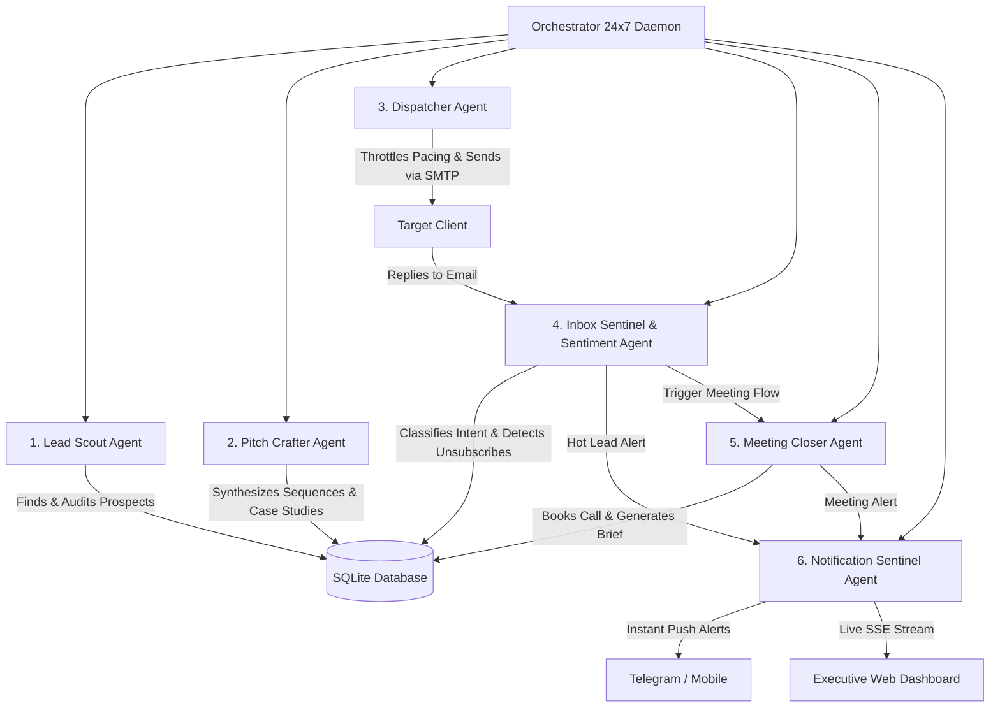

# ⚡ JESORA TECH (jesoratech.com) — 24x7 Autonomous Multi-Agent Client Acquisition System

An enterprise-grade, round-the-clock autonomous multi-agent outreach and client acquisition engine built specifically for **JESORA TECH** (`jesoratech.com`), Kathmandu, Nepal.

Designed to continuously find prospects, audit their digital presence, synthesize tailored consultative cold outreach, monitor inbox replies, classify intent using AI sentiment analysis, book introductory discovery calls, and keep you notified in real-time across Web and Telegram.

---

## 🏛 Multi-Agent Fleet Architecture



### 1. 🔍 Lead Scout Agent (`lead_scout`)
- Discovers high-fit companies across target niches (US/Global Startups, Local Healthcare & Clinics, Logistics, E-commerce, EdTech).
- Audits prospect websites for technical gaps (slow page load, legacy monolithic stack, missing patient portal or booking engine, unoptimized mobile viewport).
- Computes Lead Quality Score (0–100) and automatically extracts verified contact details.

### 2. ✍️ Pitch Crafter Agent (`pitch_crafter`)
- Formulates high-converting, personalized 4-step sequence copy.
- Highlights Jesora Tech's core market differentiators:
  - **100% full source code ownership** handed to the client (zero agency lock-in).
  - Agile 2-week sprints with transparent milestone demos.
  - 40–60% cost efficiency compared to domestic Western agencies with Silicon Valley quality.
- Dynamically pairs prospects with relevant **Jesora Tech live case studies**:
  - *AI SaaS / Startups* → WriteWell (`writewell.space`)
  - *Service / Automotive / Booking* → MOTOFIX HUB (`motohubfix.vercel.app`) or New Royal Salon
  - *E-Commerce & Retail* → Razzle Showroom (`razzletikapur.vercel.app`)
  - *Education & LMS* → Radiant Montessori English School (`rme.edu.np`)
  - *Community & Logistics* → We-Cycle Ames (`wecycleames.org`)
  - *Enterprise ERPs* → Bespoke Cloud ERP and OWASP-compliant architectures.

### 3. 📤 Outreach Dispatcher Agent (`dispatcher`)
- Enforces strict anti-spam deliverability limits (e.g. max 40 emails/day, 8-minute minimum delay between sends with human-like jitter).
- Restricts delivery to prospect business hours (9:00 AM – 6:00 PM).
- Supports real SMTP (Google Workspace / Gmail / AWS SES / Resend) as well as a safe **Simulation Mode (Dry Run)** for testing.

### 4. 📥 Inbox Sentinel & Sentiment Agent (`inbox_monitor`)
- Continuously scans inbound client messages.
- Deterministic and AI-driven sentiment classification:
  - 🟢 `MEETING_REQUEST` (Prospect asks for calendar / call)
  - 🔥 `INTERESTED` (Wants quote, pricing, or case studies)
  - ⚙️ `INFORMATION_REQUEST` (Tech stack, location, or team capability query)
  - ⏸️ `NOT_NOW` (Pushes follow-up by 60 days)
  - 🛑 `UNSUBSCRIBE` (Immediately blacklists lead and cancels all scheduled emails)
- Generates an executive 1-sentence summary and drafts a tailored contextual reply.

### 5. 🤝 Meeting Closer Agent (`meeting_closer`)
- Coordinates discovery calls and attaches calendar booking links (`calendly.com/jesoratech/intro-call`).
- Compiles an **Executive Client Briefing Dossier** for Rajan Thakulla and Jesora Tech architects before the call (Client profile, pain points, what was pitched, inbound questions, and suggested deal strategy).

### 6. 🔔 Notification Sentinel Agent (`notification_sentinel`)
- Dispatches instant alerts the moment a prospect replies or books a call.
- Integrated channels:
  - **Telegram Bot API**: Push alerts directly to your phone with HTML summary.
  - **Live Dashboard SSE**: Instant audio and visual toast alerts on your screen.

---

## 🚀 Quick Start Guide

### 1. Install & Test
```bash
npm install
npm test
```

### 2. Launch the 24x7 System
```bash
npm start
```
Open your browser to: **`http://localhost:3800`**

---

## 🎛 Executive Command Center Dashboard Features

- **Live Overview**: Real-time KPI cards (Total Leads, Emails Dispatched, Reply Rate %, Meetings Booked, Est. Pipeline Value).
- **Fleet Telemetry Grid**: View current operations and run counts for each of the 6 agents, with 1-click manual triggers.
- **Leads CRM**: High-density searchable table with score badges, tech audit snippets, sequence step, and full lead drawer.
- **Unified Inbound Inbox**: Browse prospect emails, sentiment badges, AI summaries, and suggested responses.
- **Built-in Reply Simulator**: Test the entire AI sentiment classification and meeting booking flow with 1 click using presets (`Meeting Request`, `Interested`, `Tech Inquiry`, `Unsubscribe`).
- **Meetings Dossier**: View scheduled Google Meet discovery calls and full executive briefings.
- **Campaigns & Sequences Manager**: Customize target niches, geolocations, keywords, and consultative templates.
- **Agent Audit Terminal**: Streaming live logs with color-coded severity levels.
- **Settings & Credentials**: Configure SMTP, Telegram bot token, send pacing, and company profile.
